<div align="center">


<br>

<a href="https://tjabo.dev"></a>


</div>

```sh
~ ❯ whoami
tjabo · self-taught developer from stockholm 🇸🇪
kth ict dropout · i build the tools i use every day
~ ❯ cat now.txt
a self-hosted media server for friends & family, a dashboard for my three machines,
my own clipping tool, and making linux gaming feel as good as it looks
```


<a href="assets/rice-magi.png">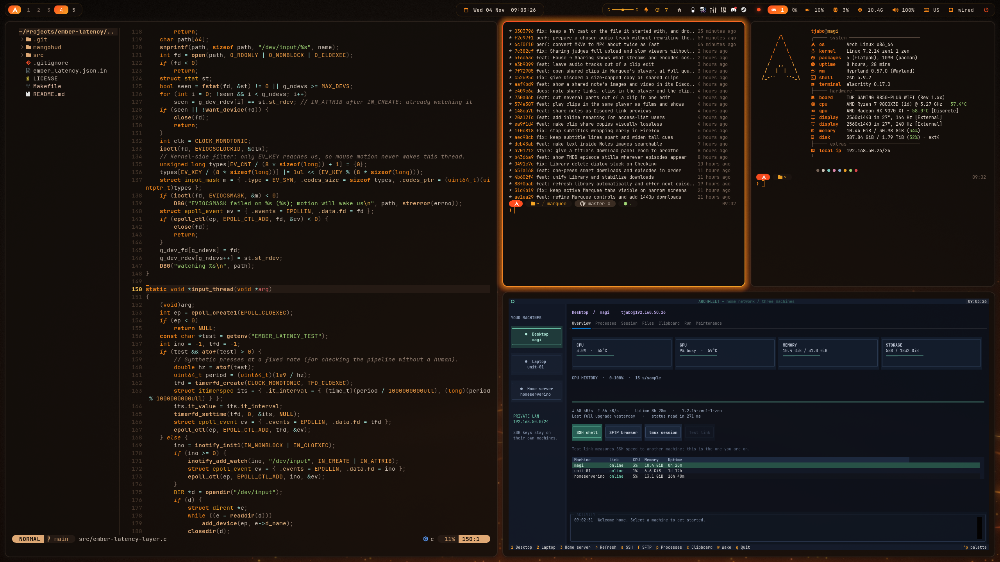</a>

<sub>**ember** on magi: hyprland · waybar · alacritty · nvim (`ember-latency`'s vulkan layer) · marquee's git log · fastfetch · archfleet</sub>


<p>
<a href="https://github.com/Tjabooo/marquee">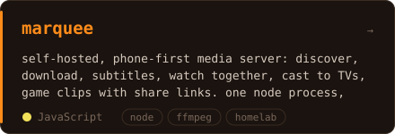</a>
<a href="https://github.com/Tjabooo/archfleet">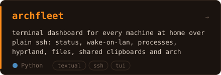</a>
<a href="https://github.com/Tjabooo/clipper">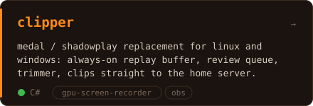</a>
<a href="https://github.com/Tjabooo/ember-latency">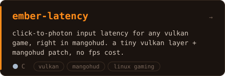</a>
<a href="https://github.com/Tjabooo/agent-mesh">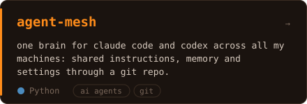</a>
<a href="https://github.com/Tjabooo/cs2-presence">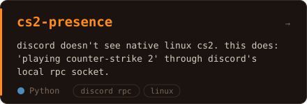</a>
</p>


| project | what it does |
| --- | --- |
| [**audition**](https://github.com/Tjabooo/audition) | "keep these changes?" for config files: a hyprland/waybar tweak reverts itself unless you keep it |
| [**steam-gamemode-all**](https://github.com/Tjabooo/steam-gamemode-all) | every steam game on feral gamemode, launch options kept |
| [**codex-ssh-windows**](https://github.com/Tjabooo/codex-ssh-windows) | a windows pc as an ssh host for the codex desktop app |
| [**dotfiles**](https://github.com/Tjabooo/dotfiles) | **neon**, the laptop's hyprland rice (midnight purple, the sibling of ember) |
| [**bevy-fps-shooter**](https://github.com/Tjabooo/bevy-fps-shooter) | fps-style target practice in rust + bevy |
| [**Tailcord**](https://github.com/Tjabooo/Tailcord) | device status in your discord bio through tailscale |
| [**tjabo.dev**](https://github.com/Tjabooo/tjabo.dev) | my site |

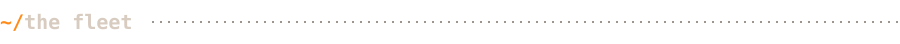

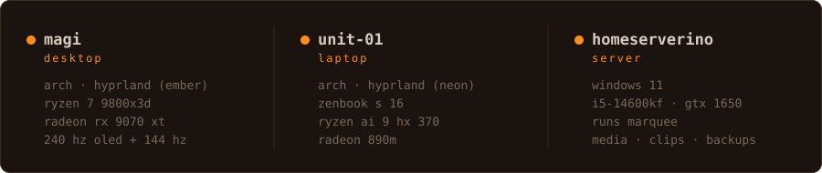

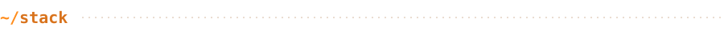

<p align="center">
<br><br>

</p>


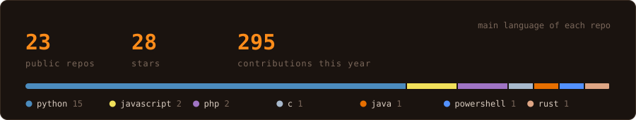

<div align="center"><sub>cards and banner are hand-made svgs (<code>assets/build.py</code>), refreshed daily by a workflow</sub></div>
