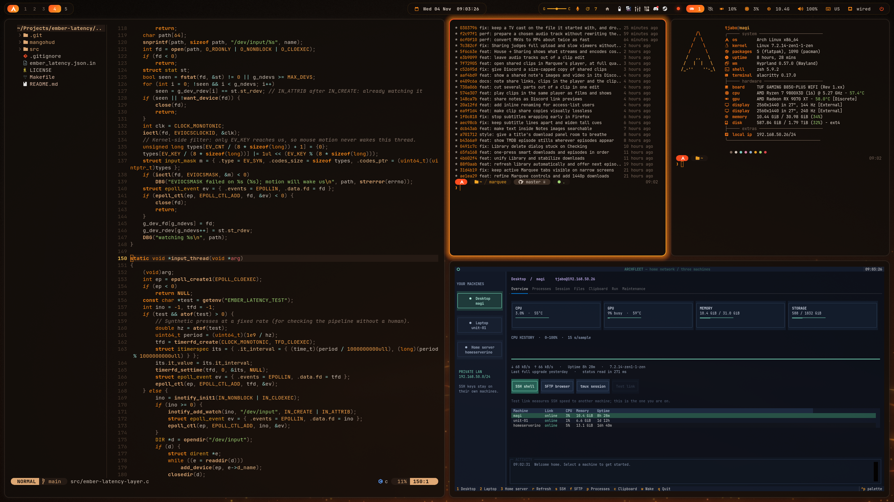
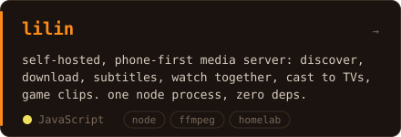
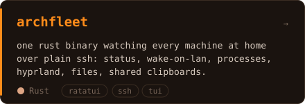
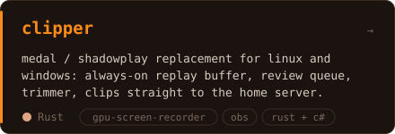
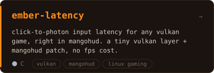
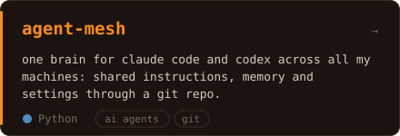
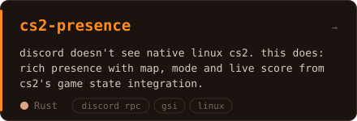
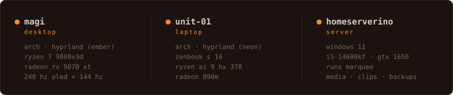
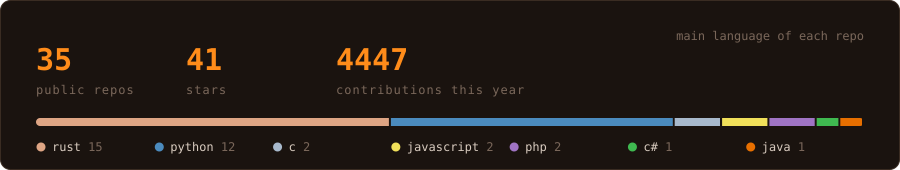

<div align="center">



<br>

<a href="https://tjabo.dev"></a>


<a href="https://ko-fi.com/tjabo"></a>

</div>

```sh
~ ❯ whoami
tjabo · self-taught developer from stockholm 🇸🇪
kth ict dropout · i build the tools i use every day
~ ❯ cat now.txt
a self-hosted media server for friends & family, a dashboard for my three machines,
my own clipping tool, and making linux gaming feel as good as it looks
```


<a href="assets/rice-magi.png"></a>

<sub>**ember** on magi: hyprland · waybar · alacritty · nvim (`ember-latency`'s vulkan layer) · lilin's git log · fastfetch · archfleet</sub>


<p>
<a href="https://tjabo.dev/projects/lilin"></a>
<a href="https://tjabo.dev/projects/archfleet"></a>
<a href="https://tjabo.dev/projects/clipper"></a>
<a href="https://tjabo.dev/projects/ember-latency"></a>
<a href="https://tjabo.dev/projects/agent-mesh"></a>
<a href="https://tjabo.dev/projects/cs2-presence"></a>
</p>


**self-hosted & homelab**

| project | what it does |
| --- | --- |
| [**lilin**](https://github.com/Tjabooo/lilin) | self-hosted media server, a plex/jellyfin alternative made for phones: watch together, dlna/airplay casting, tv apps |
| [**jellyfin-plugin-lilin**](https://github.com/Tjabooo/jellyfin-plugin-lilin) | jellyfin plugin that brings a lilin library into every jellyfin app |
| [**playhead**](https://github.com/Tjabooo/playhead) | bittorrent streaming engine in rust: deadline piece picker, seekable http range server, vpn kill switch |
| [**archfleet**](https://github.com/Tjabooo/archfleet) | terminal dashboard for your home machines over ssh: status, wake-on-lan, shared clipboards, arch maintenance |
| [**whenup**](https://github.com/Tjabooo/whenup) | offline job queue: commands for a switched-off machine run when it boots |
| [**wifiwalk**](https://github.com/Tjabooo/wifiwalk) | wi-fi site survey for linux: measure every room and find the best router spot |

**linux gaming**

| project | what it does |
| --- | --- |
| [**clipper**](https://github.com/Tjabooo/clipper) | medal / shadowplay alternative for linux and windows: always-on replay buffer, one key to clip |
| [**hearth**](https://github.com/Tjabooo/hearth) | game launcher for linux and lutris alternative: steam, repacks, per-game proton, mangohud, gamescope |
| [**lagblame**](https://github.com/Tjabooo/lagblame) | finds what caused a lag spike with ebpf: cpu scheduler, network stack, vpn, wi-fi, internet or server |
| [**lagtrace**](https://github.com/Tjabooo/lagtrace) | click-to-photon input lag of linux games, measured in software, no light sensor |
| [**ember-latency**](https://github.com/Tjabooo/ember-latency) | live input latency for any vulkan game in mangohud |
| [**nadecue**](https://github.com/Tjabooo/nadecue) | cs2 grenade lineup overlay that appears when you pull out a smoke |
| [**cs2-presence**](https://github.com/Tjabooo/cs2-presence) | discord rich presence for native linux counter-strike 2 |
| [**steam-gamemode-all**](https://github.com/Tjabooo/steam-gamemode-all) | every steam game on feral gamemode, launch options kept |

**hyprland & wayland desktop**

| project | what it does |
| --- | --- |
| [**edgehop**](https://github.com/Tjabooo/edgehop) | software kvm for wayland, like synergy / input leap: push the cursor off the edge onto the next machine |
| [**airglass**](https://github.com/Tjabooo/airglass) | airplay screen mirroring for linux: iphone/ipad to wayland with low latency |
| [**screentime**](https://github.com/Tjabooo/screentime) | iphone-style screen time for hyprland |
| [**ember-pad**](https://github.com/Tjabooo/ember-pad) | stream deck alternative on an old ipad: discord, obs, audio buses, cs2 bomb timer |
| [**audition**](https://github.com/Tjabooo/audition) | "keep these changes?" for config files: a hyprland/waybar tweak reverts itself unless you keep it |
| [**deckskin**](https://github.com/Tjabooo/deckskin) | one palette → matching cursor theme (xcursor + hyprcursor), firefox and spotify themes |
| [**dotfiles**](https://github.com/Tjabooo/dotfiles) | **neon**, the laptop's hyprland rice (arch linux, waybar, rofi, eww, plymouth) |

**streaming & discord**

| project | what it does |
| --- | --- |
| [**magi-overlay**](https://github.com/Tjabooo/magi-overlay) | self-hosted obs stream overlay: twitch chat + alerts, live cs2 stats, leetify |
| [**ashcord**](https://github.com/Tjabooo/ashcord) | vencord-style discord plugins through a local proxy, for discord's native rust client |
| [**Tailcord**](https://github.com/Tjabooo/Tailcord) | tailscale device status in your discord bio |

**ai & agents**

| project | what it does |
| --- | --- |
| [**agent-mesh**](https://github.com/Tjabooo/agent-mesh) | sync claude code memory, CLAUDE.md / AGENTS.md and settings across machines with git |
| [**seele**](https://github.com/Tjabooo/seele) | discord bot for claude code: prompt your own machine from discord |
| [**magi-consensus**](https://github.com/Tjabooo/magi-consensus) | local voice assistant where three llms vote on every action (whisper + llama.cpp) |
| [**npukit**](https://github.com/Tjabooo/npukit) | everyday local ai on the amd ryzen ai npu under linux: llm api, dictation, ocr, semantic search |

**other**

| project | what it does |
| --- | --- |
| [**bevy-fps-shooter**](https://github.com/Tjabooo/bevy-fps-shooter) | fps aim trainer in rust + bevy |
| [**tjabo.dev**](https://github.com/Tjabooo/tjabo.dev) | my site: every project with docs, synced from github |





<p align="center">
<br><br>

</p>




<div align="center"><sub>cards and banner are hand-made svgs (<code>assets/build.py</code>), refreshed daily by a workflow</sub></div>
